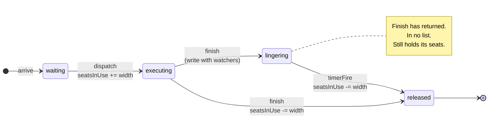
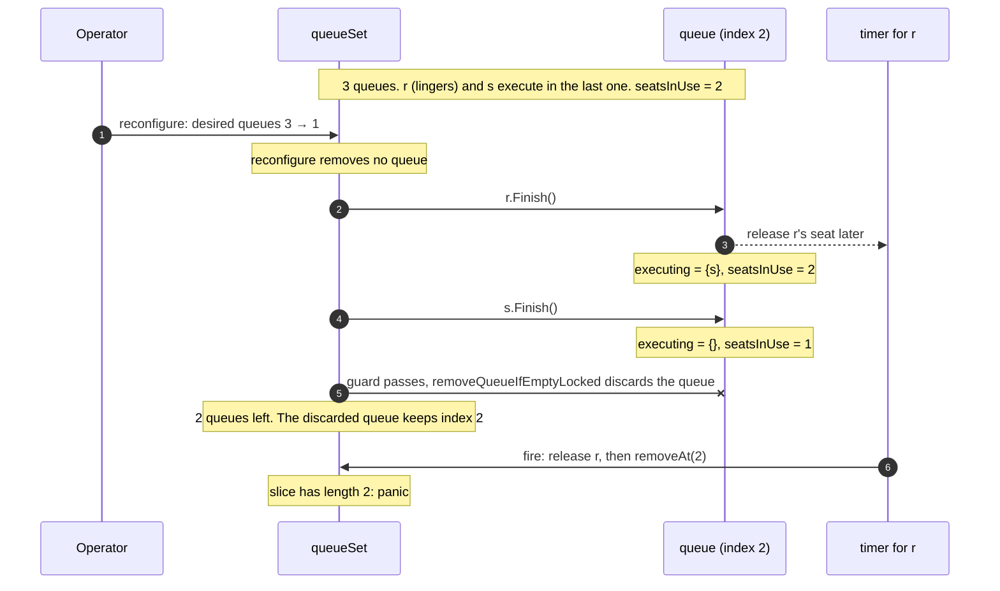
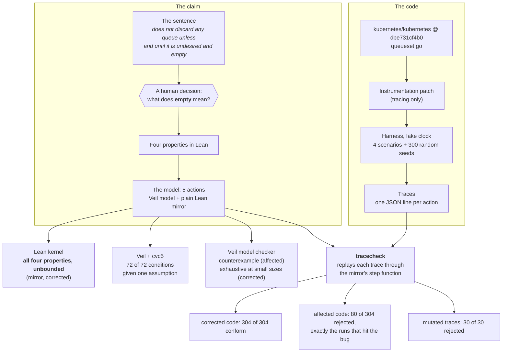
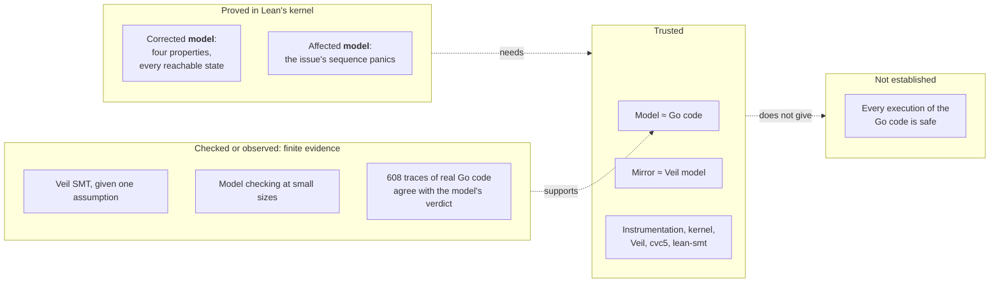

# k8s-apf-formalized

A Lean 4 and [Veil](https://github.com/verse-lab/veil) formalization of one promise that Kubernetes [API Priority and Fairness](https://kubernetes.io/docs/concepts/cluster-administration/flow-control/) (APF) makes. We check the formalization against traces of the real Go code.

## The specification

We did not write the specification. The Kubernetes authors wrote it, in three places. This repository formalizes one sentence, and the other two places say the same thing.

> **In any case, reconfiguration does not discard any queue unless and until it is undesired and empty.**
>
> The `QueueSet` interface, [`staging/src/k8s.io/apiserver/pkg/util/flowcontrol/fairqueuing/interface.go`, lines 66 to 67](https://github.com/kubernetes/kubernetes/blob/dbe731cf4b0286d68d743068f251263c70719f3e/staging/src/k8s.io/apiserver/pkg/util/flowcontrol/fairqueuing/interface.go#L60-L68), in the doc comment of `BeginConfigChange`.

> A decrease is handled by making a distinction between the desired and the actual number of queues. When the desired number drops below the actual number, the undesired queues are left in place until they are naturally drained; new requests are put in only the desired queues. **When an undesired queue becomes empty it is deleted** and the fair queuing round-robin pointer is advanced if it was pointing to that queue.
>
> The design, [KEP-1040, "Reaction to Configuration Changes"](https://github.com/kubernetes/enhancements/blob/master/keps/sig-api-machinery/1040-priority-and-fairness/README.md#reaction-to-configuration-changes).

> Removing queues is handled by attrition, **removing a queue when it goes empty and there are too many.**
>
> The implementation, [`queueset.go`, in `setConfiguration`](https://github.com/kubernetes/kubernetes/blob/dbe731cf4b0286d68d743068f251263c70719f3e/staging/src/k8s.io/apiserver/pkg/util/flowcontrol/fairqueuing/queueset/queueset.go#L258-L261).

Two more sentences, one from the user-facing documentation and one from the same interface, fix what the words mean.

> To account for this work, API Priority and Fairness considers **every write request to spend some additional time occupying seats after the actual writing is done.**
>
> The documentation, [API Priority and Fairness, "Execution time tweaks for watch requests"](https://kubernetes.io/docs/concepts/cluster-administration/flow-control/#execution-time-tweaks-for-watch-requests).

> If this method returns a nil Request value then caller should reject the request [...]. Otherwise idle==false and **the client must call the Finish method of the Request exactly once.**
>
> The `QueueSet` interface, [`interface.go`, doc comment of `StartRequest`](https://github.com/kubernetes/kubernetes/blob/dbe731cf4b0286d68d743068f251263c70719f3e/staging/src/k8s.io/apiserver/pkg/util/flowcontrol/fairqueuing/interface.go#L78-L90). This one is an assumption about callers, and we use it as one.

This sentence matters because APF exists, in the documentation's words, to stop "a flood of inbound requests from overloading and potentially crashing the API server". Its queues isolate one client from another. If the queue set removes a queue while a request still holds seats in it, the later release of those seats acts on a queue that is no longer in the queue set.

### Our reading of "empty"

Checking the sentence requires a meaning for "empty". The second quotation above says a request can be finished and still occupy seats. The code calls such a request *lingering*. No list holds a lingering request. Only its queue's `seatsInUse` counts it, and the timer callback that will release its seats holds a pointer back to the queue.

We read the specification this way, and this reading is ours:

**A queue is empty when no request assigned to it is waiting, executing, or lingering.**

Under the weaker reading (nothing waiting, nothing executing), the code at the pinned commit discards queues that still hold seats. That is [Kubernetes issue #144077](https://github.com/kubernetes/kubernetes/issues/144077). Sai krishna Bodapati ([@bodapatisaikrishna](https://github.com/bodapatisaikrishna)) reported it on November 12, 2026, and proposed the fix in [PR #144078](https://github.com/kubernetes/kubernetes/pull/144078). **We did not find this bug. We reproduced it, modeled it, and proved the proposed fix correct for a model.** As of November 25, 2026 the issue is open and nobody has merged the PR.

## What this repository establishes

The proofs are about a model, and the traces are the only link to the Go code.

| | Claim | Evidence | Where |
| -- | -- | -- | -- |
| **Proved** | In the corrected model, every reachable state satisfies `conservation`, `release_once`, `safe_retirement` and `index_integrity`. The result holds for any number of queues, any finite set of requests, and any widths. | Lean kernel. No SMT, no Mathlib, no `sorry`. Axioms: `propext`, `Classical.choice`, `Quot.sound`. | `Mirror.corrected_safe` in [`ApfQueueSet/Mirror.lean`](ApfQueueSet/Mirror.lean) |
| **Proved** | In the affected model, the sequence from the issue reaches a panic, after discarding a queue that was not empty. | Lean kernel, by `decide`. | `Mirror.issue_144077_panics` |
| **Checked** | In the corrected Veil model, 72 of 72 verification conditions hold: 69 by cvc5 with proof reconstruction in Lean, 3 by hand. **Given one assumption** about seat counts, which is itself a theorem of the mirror. | Veil `#check_invariants` | [`ApfQueueSet/Corrected.lean`](ApfQueueSet/Corrected.lean) |
| **Checked** | Exhaustive model checking of the corrected Veil model at small sizes finds no violation. The affected model has a 7-step counterexample. | Veil `#model_check` | [`proof-status.md`](proof-status.md), section 3 |
| **Observed** | The reported failure reproduces on `kubernetes/kubernetes` at `dbe731cf4b0`: early removal, panic, and removal of a different, live queue. | `go test`, fake clock | [`go/RESULTS.md`](go/RESULTS.md) |
| **Observed** | 304 of 304 traces of the corrected Go code conform to the model. Of 304 traces of the affected Go code, the checker rejects 80: exactly the runs that hit the bug. The checker also rejects 30 of 30 mutated traces. | `tracecheck`, which replays traces through the function the theorems are about | [`proof-status.md`](proof-status.md), section 5 |
| **Trusted** | The model is a faithful abstraction of the Go code, within the scope below. | Reading the code. Trace conformance is evidence, not proof. | [`docs/model-contract.md`](docs/model-contract.md) |
| **Trusted** | The plain Lean model (the "mirror") and the Veil model describe the same system. | We compared them by reading both, and we list the differences. | header of `Mirror.lean`, [`NOTES-veil.md`](NOTES-veil.md) |
| **Trusted** | The instrumentation reports the state truthfully. Lean's kernel, Veil's condition generator, cvc5 and lean-smt are sound. | | [`go/patches/0002-instrumentation.patch`](go/patches/0002-instrumentation.patch) |
| **Not established** | That every execution of the Go code satisfies the properties. There is no refinement proof. | | |
| **Not established** | Fairness, absence of starvation, or that seats are eventually released. Anything about cancellation, exempt priority levels, or an API server under a real clock. | | |

## The phases of a request

A request moves through four phases. The third phase, lingering, is the subject of this repository.



## The reported failure

This failure is the one [issue #144077](https://github.com/kubernetes/kubernetes/issues/144077) reports. The guard in `removeQueueIfEmptyLocked` that decides whether to remove a queue checks the queue's waiting list and executing set, and does not check its `seatsInUse`.



When the stale index is still in range, `removeQueueAndUpdateIndexes` does not panic at that point, and removes a different, live queue instead. In our runs, when that queue held a waiting request, the queue set never dispatched the request, and the next dispatch panicked with a nil dereference. [`go/RESULTS.md`](go/RESULTS.md) has the details.

The fix that PR #144078 proposes adds one conjunct:

```diff
 	if len(qs.queues) > qs.qCfg.DesiredNumQueues &&
 		r.queue.requestsWaiting.Length() == 0 &&
-		r.queue.requestsExecuting.Len() == 0 {
+		r.queue.requestsExecuting.Len() == 0 &&
+		r.queue.seatsInUse == 0 {
```

## The model

The full contract is [`docs/model-contract.md`](docs/model-contract.md). The model has one `queueSet` and five actions, and each action is a critical section under the queue set's lock.

| Action | Go function | Effect |
| -- | -- | -- |
| `reconfigure(n)` | `setConfiguration` | set the desired count. Add queues if it grew. Never removes a queue. |
| `arrive(r, q)` | `shuffleShardAndRejectOrEnqueueLocked` | request `r` waits in queue `q` |
| `dispatch(r)` | `dispatchLocked` | `r` executes and takes its seats |
| `finish(r)` | `finishRequestLocked` | `r` lingers, or releases its seats now |
| `timerFire(r)` | the `EventAfterDuration` callback | a lingering `r` releases its seats |

After the model releases a request's seats, it calls `removeQueueIfEmpty`, as the Go code calls `removeQueueIfEmptyLocked`. The affected and the corrected model differ only in that function's guard, by the same conjunct as the Go code:

```lean
def removeGuard (rs : List R) (corrected : Bool) (s : St Q R) (q : Q) : Bool :=
  decide (s.desired < s.slice.length) &&
  rs.all (fun x => !(s.rq x == q && s.phase x == .waiting)) &&
  rs.all (fun x => !(s.rq x == q && s.phase x == .executing)) &&
  (!corrected || s.seats q == 0)
```

We wrote the model twice:

- [`ApfQueueSet/Affected.lean`](ApfQueueSet/Affected.lean) and [`ApfQueueSet/Corrected.lean`](ApfQueueSet/Corrected.lean): in Veil's language, for the model checker and for SMT. The script `scripts/gen_corrected.py` generates `Corrected.lean` from `Affected.lean`, so the two differ in the guard and in nothing else that matters, and `make check-parallel` checks that the generated file is up to date.
- [`ApfQueueSet/Mirror.lean`](ApfQueueSet/Mirror.lean): in plain Lean, for the kernel-checked proofs and for the trace checker.
- `AffectedMC.lean` and `CorrectedMC.lean`: generated copies of the Veil models for the model checker, with no assumption in them.

We wrote it twice because `conservation` is a sum over requests, which is not a first-order statement, so Veil's SMT pipeline cannot handle it. The full proof is in plain Lean, and Veil checks the Veil model alongside it. Only inspection establishes that the two models describe the same system, so the table above lists that agreement as trusted.

## The four properties

`Mirror.lean` states them in Lean:

```lean
/-- `conservation`: the counters equal an independent ledger of reservations. -/
def Conservation (rs : List R) (s : St Q R) : Prop :=
  (∀ q, s.seats q = heldQ rs s q) ∧ s.tot = heldAll rs s ∧
  (∀ q, 0 ≤ s.seats q) ∧ 0 ≤ s.tot
-- heldQ rs s q : the sum of `width r` over requests that are executing or lingering in `q`

/-- `release_once`: `releases r` counts how often `r`'s seats were released. -/
def ReleaseOnce (s : St Q R) : Prop := ∀ r, s.releases r ≤ 1

/-- `safe_retirement`: the sentence from the interface. -/
def SafeRetirement (s : St Q R) : Prop :=
  s.discarded = false ∧ ∀ r, (s.phase r).live → s.rq r ∈ s.slice
-- `discarded` is set when a queue leaves the slice while some request in it is
-- waiting, executing or lingering. `live` means waiting, executing or lingering.

/-- `index_integrity`: no panic, and stored indexes are exactly the positions. -/
def IndexIntegrity (s : St Q R) : Prop :=
  s.panicked = false ∧
  (∀ q1 q2, q1 ∈ s.slice → q2 ∈ s.slice → s.idx q1 = s.idx q2 → q1 = q2) ∧
  (∀ q, q ∈ s.slice → s.idx q < s.slice.length) ∧
  (∀ i, i < s.slice.length → ∃ q, q ∈ s.slice ∧ s.idx q = i)
```

And the theorem:

```lean
theorem ApfQueueSet.Mirror.corrected_safe :
  ∀ {Q R : Type} [DecidableEq Q] [DecidableEq R] (rs : List R),
    (∀ (r : R), r ∈ rs) → rs.Nodup →
    ∀ {s : St Q R}, Reachable rs true s →
      Conservation rs s ∧ ReleaseOnce s ∧ SafeRetirement s ∧ IndexIntegrity s
```

`Reachable rs true` is every state the corrected model can get to from a freshly constructed queue set. `release_once` is close to true by construction, since an action can only release a request in the right phase. We state it anyway, with a counter, so that the Lean kernel checks it instead of the reader taking it on our word.

## How the verification works



This diagram separates what we proved from what we checked, observed, or trust:



## Results

The commands in the next section produced every number here, on November 25, 2026, on macOS on Apple silicon. [`proof-status.md`](proof-status.md) gives the exact statements, clause by clause.

**Reproduction of the reported failure** ([`go/RESULTS.md`](go/RESULTS.md)). On the pinned commit the PR author's own regression test fails with `got 2 queues while the lingering request still holds seats, want 3`, and passes with the fix. Our harness continues past that point, and we observe `panic: runtime error: slice bounds out of range [3:2]` in `removeQueueAndUpdateIndexes` and, in other scenarios, the removal of a different, live queue. Over 300 random seeds, 76 runs of the affected code hit the bug and 18 of those end in a panic, and no run of the corrected code hits the bug. Everything runs under the package's fake event clock, and we did not run an API server.

**Proofs** ([`ApfQueueSet/Mirror.lean`](ApfQueueSet/Mirror.lean), [`axioms.txt`](axioms.txt)). `corrected_safe` is the theorem stated above. `conservation_reachable` shows that the affected model also conserves seat accounting: the counters stay correct, and the bug is that the affected model discards the queue that holds them. `issue_144077_panics` shows that the affected model reaches a panic.

**Veil** ([`ApfQueueSet/Corrected.lean`](ApfQueueSet/Corrected.lean)). Veil generates 72 verification conditions: 12 clauses for the initializer and for each of the 5 actions. cvc5 discharges 69 of them with `veil.smt.trust false`, so Veil reconstructs a Lean proof from the solver's answer. The other 3, which say that every index position is taken, time out in cvc5, and we proved them by hand. The proof of `safe_retirement` uses one `assume`: two distinct requests holding seats in one queue fit within that queue's `seatsInUse`. That fact follows from `conservation`, and `conservation_fo_reachable` proves it for the mirror, but it is still an assumption of the Veil result.

**Model checking** ([`proof-status.md`](proof-status.md), section 3). Veil's model checker explores a variant of the Veil model with no assumption in it ([`CorrectedMC.lean`](ApfQueueSet/CorrectedMC.lean)) exhaustively, and checks every state against all the clauses above and against `conservation` in its sum form. With 3 queues, 3 requests and widths 1 to 3 it explores 1,243,842 states, and with 4 queues, 4 requests and widths 1 to 2 it explores 5,753,283 states. It finds no violation. For the affected variant it finds a counterexample to `safe_retirement` in 7 actions, which we saved in [`counterexamples/`](counterexamples/). These are results about small instances, so the table above lists them as checked, not proved.

**Traces** (`make check-traces`). `tracecheck` replays each trace through `Mirror.apply`, the same function `corrected_safe` is about. Each line must be an enabled action, the model's next state must equal the snapshot the Go code reported, and the four properties must hold in it.

| Traces | Files | Result |
| -- | -- | -- |
| corrected Go code | 304 | 304 conform |
| affected Go code | 304 | 224 conform, 80 rejected. The 80 are the 76 seeds and 4 scenarios that hit the bug. |
| mutated copies of conforming traces | 30 | 30 rejected |

Every rejected trace of the affected code fails first on `safe_retirement`, before any panic appears in the trace.

## How to reproduce the results

Requirements: [elan](https://github.com/leanprover/elan) (`lean-toolchain` selects Lean 4.35.0), Go 1.27, `git`, `make`, and [`uv`](https://docs.astral.sh/uv/) for two small scripts.

```sh
make verify          # build everything: SMT checks, model checking, kernel proofs, #print axioms
make check-traces    # replay the committed traces and compare with the expected verdicts

cd go
./fetch.sh               # Kubernetes at the pinned commit, sparse checkout, into go/upstream
./run.sh pr-test         # the PR's regression test: fails unpatched, passes patched
./run.sh affected 300    # regenerate traces/affected
./run.sh corrected 300   # regenerate traces/corrected
uv run mutate.py         # regenerate traces/mutated
```

The first `lake build` fetches Veil and cvc5 and takes a few minutes. Trace generation is deterministic: two runs give identical files.

## Generating the Go fix from the specification

You can generate the fix from the Lean specification instead of writing it by hand.

```
make gen-fix     # writes go/patches/0003-fix-from-spec.patch
make check-fix   # runs the Go code with the generated fix, replays its traces in Lean
```

`ApfQueueSet/Synth.lean` states "empty" as a list of request phases, derives a guard from that
list, proves the derived guard is true exactly when the queue is undesired and empty
(`derived_strict_iff_spec`), and prints it as Go.

- **Strict reading** (waiting, executing, lingering): the output is byte-identical to `queueset.go` with PR #144078 applied.
- **Naive reading** (waiting, executing): the output is byte-identical to the affected upstream code.

The bug is the difference between the two lists. We trust the table that maps model observations to Go
expressions, and there is still no refinement proof. [docs/spec-to-go.md](docs/spec-to-go.md) has the
details and the full ledger.

## Assumptions and scope

The guarantee applies only where these assumptions hold. Each one marks a place where the real system can do something the model does not cover.

- The model covers one non-exempt queue set, in one API server process.
- The desired number of queues is always positive.
- No request context is cancelled, and no request times out while waiting. The cancellation path does not call `removeQueueIfEmptyLocked` at all, and we have not modeled it.
- The client calls `Finish` exactly once for every request that starts, as the interface requires of callers.
- The event clock runs each callback at most once.
- Every action is atomic. In Go each one runs under `qs.lock`.
- The model chooses nondeterministically which queue a request joins, which request the queue set dispatches next, and whether there is room for it. So the model allows every schedule the fair-queuing algorithm could produce, and more, and as a consequence it says nothing about fairness.
- The kernel theorem covers a finite number of requests (the finite list `rs`) and puts no bound on the number of queues.

The model leaves out virtual time, the round-robin index, the concurrency limit, rejection, metrics, and borrowing between priority levels.

## Layout

| Path | What |
| -- | -- |
| [`docs/model-contract.md`](docs/model-contract.md) | state, actions, properties and trace schema shared by everything else |
| [`ApfQueueSet/`](ApfQueueSet/) | the Veil models, the mirror and its proofs, the trace checker |
| [`proof-status.md`](proof-status.md) | every theorem statement, how each was discharged, what is trusted |
| [`NOTES-veil.md`](NOTES-veil.md) | where the Lean side departs from the contract, and Veil limits we hit |
| [`counterexamples/`](counterexamples/) | the model checker's counterexample, a replay of the issue, all trace verdicts |
| [`go/`](go/) | fetch script, the fix and the instrumentation as patches, harness, results |
| [`traces/`](traces/) | recorded traces: `affected`, `corrected`, `mutated`, `handmade` |

## Credit and prior work

- Sai krishna Bodapati found and reported the failure in [kubernetes/kubernetes#144077](https://github.com/kubernetes/kubernetes/issues/144077), and proposed the fix in [#144078](https://github.com/kubernetes/kubernetes/pull/144078). `go/patches/0001-fix-144078.patch` is that fix, verbatim.
- [Antithesis, "Verifying formal models of Raft implementations"](https://antithesis.com/blog/2026/verifying-formal-models/) is the direct inspiration for pairing a proved model with trace validation. Their proofs, like ours, are about models.
- [Anvil](https://github.com/anvil-verifier/anvil) verifies Kubernetes controller implementations. [Kivi](https://www.usenix.org/system/files/atc24-liu-bingzhe.pdf) model-checks cluster behavior. Neither targets APF.
- As of November 25, 2026 we found no public formal model of APF queue retirement and seat accounting. That is the result of a dated search, and we do not claim that no such model exists.
- The VERSE lab develops [Veil](https://github.com/verse-lab/veil). To learn Lean, see [Functorial Academy](https://academy.functorial.inc/).

The patches under `go/patches/` modify Kubernetes source code, which uses the Apache 2.0 license.

Made by [Functorial](https://functorial.inc). Our [principles](https://functorial.inc/principles): make the claim inspectable, state the conditions and the scope, own the meaning.
